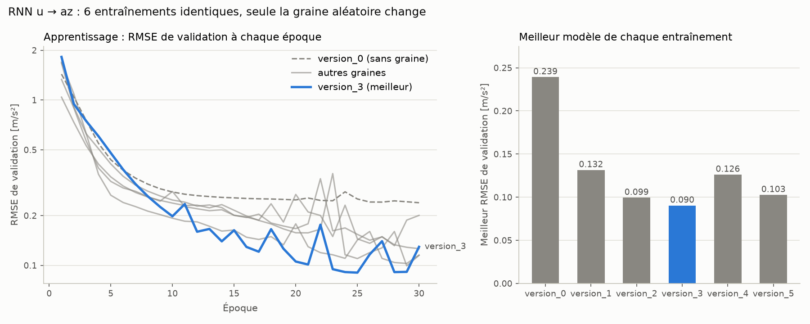

# Identification du drone par RNN

Modèle **u → az** (commande moteur → accélération verticale), appris sur les bases nettoyées de
[`../data_base_cleaning`](../data_base_cleaning). C'est le modèle sur lequel l'agent RL sera entraîné.

**Modèle retenu : `version_3`** (poids MATLAB / Python dans `model_rnn/lightning_logs/version_3/export_NN/`).

| Dossier / fichier | Contenu |
|---|---|
| `RNN_drone.py` | Algorithme : entraînements (PyTorch Lightning), choix du meilleur, test, export des poids au format MATLAB |
| `compare_runs.py` | Comparaison des entraînements : tableau des résultats et `model_rnn/comparison_runs.png` |
| `model_rnn/lightning_logs/version_N/` | Un entraînement : checkpoint `.ckpt`, `run_info.json` (données, normalisation, hyperparamètres, graine, résultats) |
| `model_rnn/.../export_NN/` | Poids du RNN en `.txt`, lisibles par MATLAB (`version_0` et `version_3`) |
| `model_rnn/comparison_runs.png` | Figure comparative des 6 entraînements |
| `matlab_test/` | `test_RNN.m` + `test_RNN_harness.slx` : même u envoyé à `UAV_model.slx` et au RNN, comparaison de az |
| `figures/` | Captures des tests de validation sous MATLAB (`version_0`) |

## Modèle
- RNN simple (tanh), 1 couche, 16 neurones, 321 paramètres ; Ts = 0.05 s
- Normalisation : u inchangé (déjà dans [-1, 1]), az_n = (az + 9.81) / 20
- 30 époques, lr = 3e-3 ; essais répartis 70 / 15 / 15 % (train / val / test)
- Équations (pas à pas, h0 = 0) :
  `h = tanh(Wih*u + Whh*h + bh)` puis `az = 20*(Wo*h + bo) - 9.81`

## Résultats

### Choix du modèle : 6 entraînements, seule la graine aléatoire change
Les poids initiaux et l'ordre des batchs sont tirés au hasard : à réglages identiques, le RMSE va de
0.090 à 0.239 m/s². Le meilleur est choisi sur la **validation** ; le test (450 essais jamais vus) sert
uniquement à vérifier ce choix.

| Version | Graine | Meilleure époque | RMSE validation [m/s²] | RMSE test [m/s²] |
|---|---|---|---|---|
| version_0 | aucune | 30 / 30 | 0.239 | 0.239 |
| version_1 | 1 | 28 / 30 | 0.132 | 0.132 |
| version_2 | 2 | 29 / 30 | 0.099 | 0.099 |
| **version_3** | **3** | **25 / 30** | **0.090** | **0.090** |
| version_4 | 4 | 30 / 30 | 0.126 | 0.126 |
| version_5 | 5 | 29 / 30 | 0.103 | 0.103 |

`version_3` : R² = 0.99994 sur le test.

La plupart des entraînements atteignent leur meilleur score aux dernières époques : plus d'époques
amélioreraient encore le modèle.

### Validation sous MATLAB contre `UAV_model.slx` (signaux aléatoires de 20 s jamais vus)

| Modèle | g_noise | RMSE [m/s²] |
|---|---|---|
| **version_3** | 0 | **0.072** |
| **version_3** | 0.1 | **0.095** |
| version_0 (`test1/2/3_RNN.png`) | 0 | 0.177 / 0.270 / 0.253 |
| version_0 (`test1/2_RNN_Noise.png`) | 0.1 | 0.233 / 0.266 |

L'erreur face au simulateur est la même qu'en Python : le dataset représente bien le simulateur à Ts = 0.05 s.

## Utilisation
- **Réentraîner** : `python RNN_drone.py` lance `nb_train` entraînements (graines `seed`, `seed + 1`...) dans
  `model_rnn/lightning_logs/version_N`, affiche le tableau de toutes les versions et garde la meilleure en
  validation. Les poids MATLAB sont écrits après la fermeture des figures.
  `TRAIN = False` recharge le checkpoint de `version_3` sans réentraîner.
- **Comparer les entraînements** : `python compare_runs.py` (tableau + figure).
- **Tester sous MATLAB** : lancer `matlab_test/test_RNN.m`, pas le `.slx` (c'est le script qui crée
  `u_ts` et `Ts`). Pour un autre modèle, changer `version_3` dans `test_RNN.m`.
