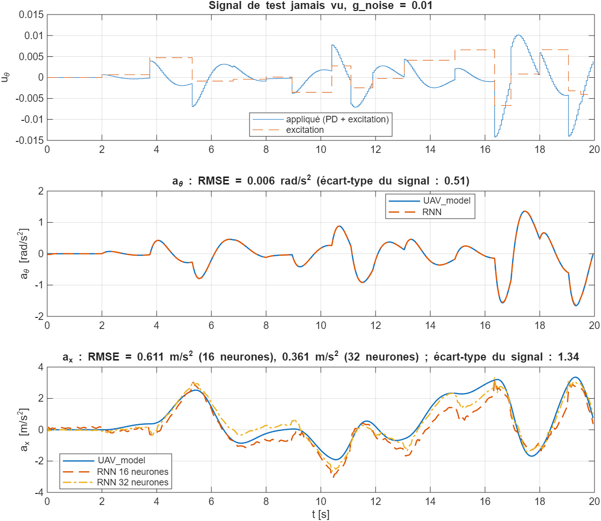

# Identification du tangage par RNN : u_theta → a_theta et u_theta → ax

Deux RNN entraînés sur les bases de [`../generation_donnees_x_theta`](../generation_donnees_x_theta), avec le même
code que le RNN de az (`RNN_drone_xtheta.py` est une copie de `identification_RNN/RNN_drone.py`, adaptée).

| Dossier / fichier | Contenu |
|---|---|
| `RNN_drone_xtheta.py` | Entraînement, test, export : `python RNN_drone_xtheta.py <atheta ou ax> [neurones, 16 par défaut]` |
| `RNN_a_theta_16neurones/`, `RNN_ax_16neurones/`, `RNN_ax_32neurones/` | Poids : 3 entraînements par modèle (graines 1 à 3), le meilleur en validation est exporté dans `export_NN/` (voir le README de chaque dossier) |
| `matlab_test/test_RNN_xtheta.m` | Test face au simulateur : même u_theta envoyé à `boucle_tangage.slx` et aux deux RNN |
| `figures/` | Séquences de test, réponses indicielles, test MATLAB |

## Modèle
- Comme pour az : RNN simple (tanh), 1 couche, 16 neurones (32 pour la meilleure version de ax), 30 époques, lr = 3e-3, essais répartis 70 / 15 / 15 %.
- Normalisation : u_n = u_theta / 0,02 ; sortie / 2,6 (a_theta) ou / 4,5 (ax), sans décalage (0 au repos).
- Équations (pas à pas, h0 = 0) : `h = tanh(Wih*u_n + Whh*h + bh)` puis `y = y_scale*(Wo*h + bo)`.

## Résultats

| Sortie | Modèle retenu | Test Python (450 essais de 100 s) | Test MATLAB (signal de 20 s jamais vu) | Écart-type du signal |
|---|---|---|---|---|
| **a_theta** (16 neurones) | `RNN_a_theta_16neurones/.../version_2` | RMSE 0.006 rad/s², R² = 0.99986 | RMSE 0.005 rad/s² | 0.55 rad/s² |
| ax (16 neurones) | `RNN_ax_16neurones/.../version_0` | RMSE 0.828 m/s², R² = 0.779 | RMSE 0.611 m/s² | 1.76 m/s² |
| **ax (32 neurones)** | `RNN_ax_32neurones/.../version_1` | RMSE 0.661 m/s², R² = 0.859 | RMSE 0.361 m/s² | 1.76 m/s² |

- **a_theta** : le RNN reproduit le simulateur presque parfaitement, comme pour az (a_theta dépend directement de
  u_theta, à travers la dynamique des moteurs).
- **ax** : la forme et les instants sont bons, mais l'erreur reste importante et grandit sur les longues
  séquences. ax dépend de theta, la **double intégrale** de a_theta : le RNN doit reconstruire cette double
  intégration à partir de u_theta seul. À 16 neurones, les 3 graines butent au même niveau (0,83 à 0,85 m/s² en
  validation) ; **32 neurones** font nettement mieux (0,68 à 0,72 m/s², et 0,36 m/s² face au simulateur).
- Enchaîner le RNN de a_theta, une double intégration et ax = 9,45·theta dérive en boucle ouverte (RMSE 37 m/s²
  sur 100 s) : la moindre erreur s'accumule. En revanche, dans un environnement RL (comme z intégré à partir de
  az), theta est un état de l'environnement et le contrôleur referme la boucle.

## Utilisation
- **Réentraîner** : `python RNN_drone_xtheta.py ax 32` (sortie, puis nombre de neurones). `TRAIN = False` recharge le modèle retenu.
- **Tester sous MATLAB** : lancer `matlab_test/test_RNN_xtheta.m` (il utilise `boucle_tangage.slx` et compare a_theta, ax à 16 et à 32 neurones ;
  poids lus dans `export_NN` de chaque dossier).
