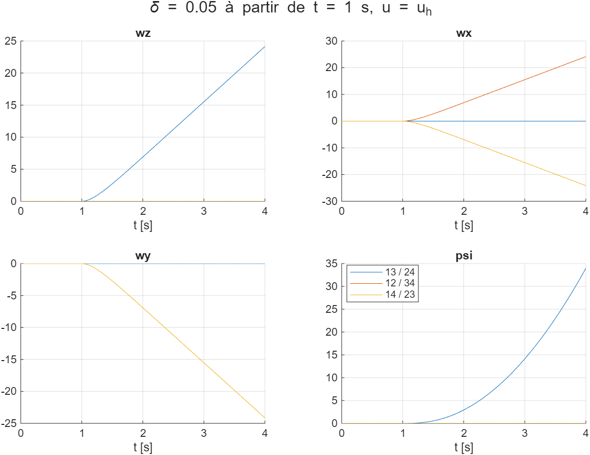
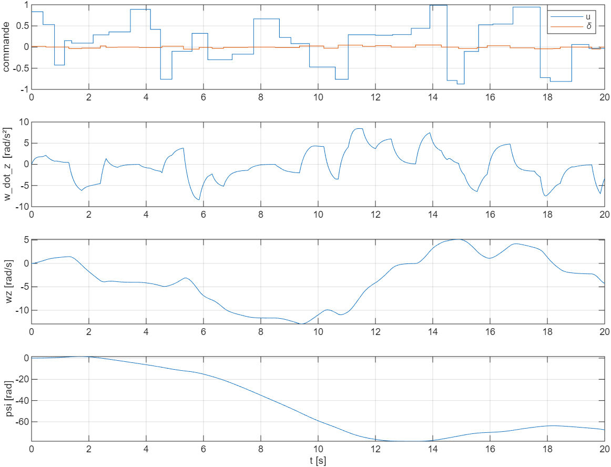

# Lacet : faire tourner le drone sur lui-même

Tâche avancée du sujet : *« Make the drone rotate on itself at the end of step 2 »*, c'est-à-dire tourner en lacet
ψ pendant le palier à 0.5 m. Ce dossier identifie le lacet sur le simulateur `UAV_model.slx`. L'intégration dans
l'environnement RL ([`../rl_interface`](../rl_interface)) reste à faire (voir la dernière partie).

| Fichier | Contenu |
|---|---|
| `lacet.ipynb` | **Compte rendu** : schémas, paire de moteurs, sens de rotation, couplage, modèle Python du lacet |
| `generer_donnees_lacet.m` | Simulations : vol stationnaire, choix des moteurs, balayages, données (MATLAB, ~4 min) |
| `tests_lacet.mat` | Essais sans bruit (3 répartitions de δ, balayages en δ et en u) |
| `donnees_lacet.mat` | 100 vols de 20 s : commandes u, δ, moteurs et sorties ψ, wz, w_dot_z, az... |
| `figures/` | Test des répartitions de δ, exemple de vol |

## Pourquoi de nouvelles données
- Dans `EINT_RL_closed_loop.slx`, la commande u de la policy est envoyée aux 4 moteurs (`u1` à `u4`). Quatre
  moteurs identiques ne créent aucun couple de lacet : le drone ne peut pas tourner.
- Les données fournies n'ont qu'une entrée u et qu'une sortie az : le RNN (`u → az`) ne sait rien du lacet.

On ajoute donc une **commande différentielle δ** : `u_i = u + s_i·δ`, avec deux moteurs à +δ et deux à −δ (la
poussée totale reste celle de u). Comme le sujet autorise à ajouter des données, on les génère sur `UAV_model.slx`.

Dans le simulateur, chaque moteur passe par cette chaîne (lue dans `UAV_model.slx`, la dynamique
`quadcopter_model.p` est protégée) :

```
u_i ──► 1/(0.2 s + 1) ──► 10·tanh(·) ──► F_i ──► quadcopter_model.p ──► ψ, wz, w_dot_z, az, φ, θ...
```

## Démarche (`generer_donnees_lacet.m`)
Le script construit en mémoire un harness (`UAV_model` entre une source de 4 commandes et un To Workspace des 18
sorties, échantillonné à Ts = 0.05 s). Il n'enregistre pas ce harness et ne modifie aucun fichier fourni.

1. **Vol stationnaire** : la commande u_h qui donne az = 0 est trouvée par la méthode de la sécante, sans bruit.
   On obtient **u_h = 0.3895**.
2. **Quels moteurs ?** Le modèle étant protégé, on essaie les 3 façons de répartir δ = 0.05, appliqué à partir de
   t = 1 s en vol stationnaire, sans bruit :

   | Moteurs (+δ / −δ) | wz après 3 s [rad/s] | max \|wx\|, \|wy\| [rad/s] | Variation de az [m/s²] |
   |---|---|---|---|
   | **1, 3 / 2, 4** | **24.1** | **0 / 0** | **−0.02** |
   | 1, 2 / 3, 4 | 0 | 24.1 / 24.1 | −4.34 |
   | 1, 4 / 2, 3 | 0 | 24.1 / 24.1 | −4.34 |

   On retient **`u1 = u3 = u + δ` et `u2 = u4 = u − δ`** : δ > 0 donne wz > 0. Le lacet est découplé du reste :
   aucun basculement et un effet négligeable sur az, donc le RNN d'altitude reste valable. Les deux autres
   répartitions font basculer le drone.

   

3. **Données d'identification** : 100 vols de 20 s (401 pas), g_noise = 0.01 (valeur de `random_init`).
   - u : paliers aléatoires dans [−1, 1], tenus de 0.2 à 1 s (même plage que les données fournies)
   - δ : paliers dans [−0.05, 0.05], dont un sur trois est nul
   - commandes moteur `u ± δ` bornées à [−1, 1]

   Plages obtenues : wz ∈ [−39, 40] rad/s, ψ ∈ [−512, 430] rad, \|wx\|, \|wy\| < 2·10⁻³ rad/s (bruit).

   

Un premier essai avec δ ∈ [−0.3, 0.3] donnait wz jusqu'à 225 rad/s, très loin de ce que demande la mission. La plage
a donc été réduite à ±0.05.

## Résultat : modèle du lacet
Une régression sur les 100 vols donne la dynamique exacte :

`w_dot_z = 50 · (tanh(m1) − tanh(m2) + tanh(m3) − tanh(m4))`, avec m_i la commande du moteur i filtrée par 1/(0.2 s + 1)

| Régression de w_dot_z sur (80 vols, R² sur 20 autres) | Coefficients | R² validation |
|---|---|---|
| Σ s_i·tanh(m_i) et wz | 50.00 et 1·10⁻⁷ | 1.000000 (résidu 4.5·10⁻⁴ : le bruit) |
| δ seul (linéaire, sans filtre) | 117.2 | 0.74 |

La classe Python `ModeleLacet` du notebook rejoue les 20 vols de validation en boucle ouverte sur 20 s avec une
erreur max de 0.002 rad/s sur wz et de 0.006 rad sur ψ.

- **Pas besoin de réseau de neurones** : le modèle tient en quelques lignes.
- **Aucun amortissement** (coefficient sur wz nul) : ψ est un double intégrateur. Le drone continue de tourner
  tant que la commande ne le freine pas.
- Près du vol stationnaire : `w_dot_z ≈ 200·(1 − tanh²(u_h))·δ ≈ 172·δ` (δ filtré). Pour un tour en 2 s
  (accélérer 1 s puis freiner 1 s), il faut ≈ 6.3 rad/s², soit **δ ≈ 0.04**.

## Environnement RL avec le lacet
Fait, dans [`../rl_interface`](../rl_interface) (détails et vols d'essai : partie 8 de `lacet.ipynb`) :
- `modele_lacet.py` : le modèle ci-dessus (`ModeleLacet`) ;
- `Env_drone_lacet.py` : `DroneLacetEnv`, avec l'action `[u, a]` et `δ = 0.05·a`, un tour entre 4 s et 6.5 s
  pendant le palier à 0.5 m, et une observation, une récompense et un crash complétés par l'erreur de lacet.

Vols d'essai, avec l'altitude commandée par la policy PPO de Track B : sans commande de lacet, le drone crashe à
4.8 s ; avec un PD, il fait le tour (ψ final 6.31 rad, pour une cible de 6.28) mais dépasse la consigne de 0.8 rad.

| Reste à faire | Détail |
|---|---|
| Entraînement | PPO sur `DroneLacetEnv` |
| Export | variante de `export_policy.py` pour 2 actions et les mesures du lacet |
| `rl_controller.m` | Entrées ψ, wz, a_prev, sortie δ, mêmes `mission()` et `observation()` qu'en Python |
| `EINT_RL_closed_loop.slx` | Mélange `u ± δ` vers les 4 moteurs, ZOH et retards sur ψ et wz |

## Remarques sur le simulateur
- **ψ n'est pas ramené dans [−π, π]** : il faut ramener soi-même l'erreur d'angle (`atan2(sin e, cos e)`).
- **Mesure de θ** : dans `UAV_model.slx`, la covariance du bloc de bruit de θ vaut `seed_theta` (jusqu'à 10 000)
  au lieu de 10⁻⁴. Dès que g_noise > 0, θ mesuré est très bruité. Ça n'a pas d'effet sur le lacet, et les tests
  de l'étape 2 sont faits sans bruit.
- Dans `donnees_lacet.mat`, la mesure du pas k dépend des commandes des pas 0 à k−1 : comme dans la boucle RL, il
  n'y a pas de transmission directe.

## Utilisation
- **Générer les données** : lancer `generer_donnees_lacet` sous MATLAB (~4 min). Le script affiche u_h, le tableau
  des répartitions et les plages des données.
- **Lire le compte rendu** : ouvrir `lacet.ipynb`. Il lit les `.mat`, et `RELANCER_MATLAB = True` refait les
  simulations.
- **Lire les données en Python** :
  ```python
  import scipy.io as sio
  d = sio.loadmat("donnees_lacet.mat")   # une ligne = un vol, une colonne = un pas
  delta, w_dot_z, moteurs = d["delta"], d["w_dot_z"], d["moteurs"]   # moteurs : 100 x 401 x 4
  ```
