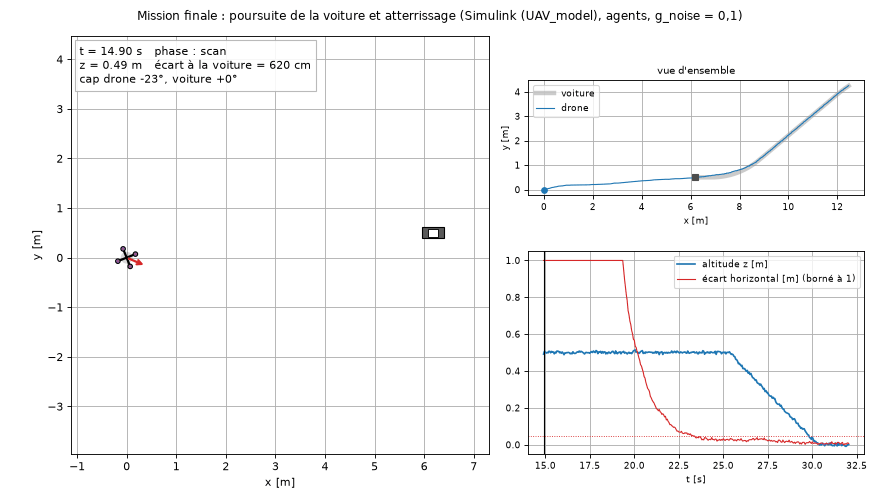
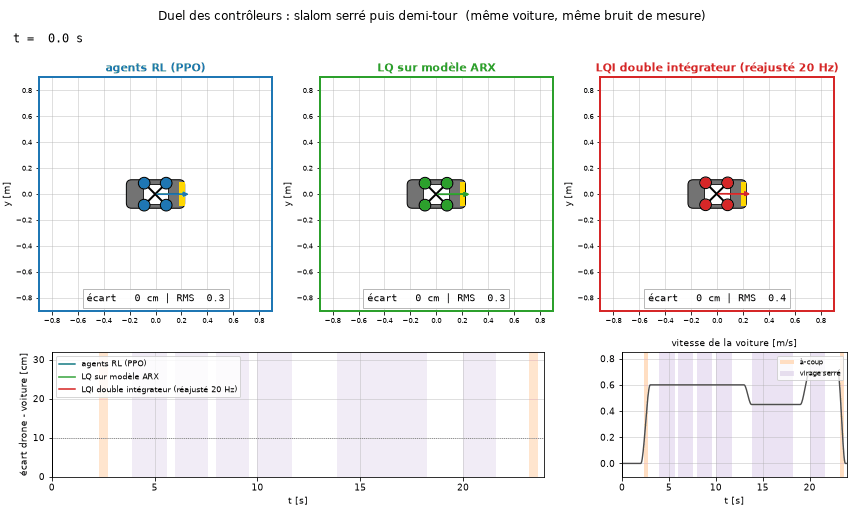

# Commande d'un quadrirotor par apprentissage par renforcement

*Reinforcement-learning control of a simulated quadcopter: system identification (GRU, ARX), PPO agents trained on the
identified models, exact transfer to MATLAB/Simulink, and a full autonomous mission (take-off, 360° scan, pursuit of a
moving car, landing on it), benchmarked against model-based LQ/LQI control.*

Projet de la semaine d'intégration **« Data-Driven Control »** de CentraleSupélec : commander un drone sans documentation,
à partir de données seulement, par apprentissage par renforcement, avec une comparaison systématique à la commande par
modèle (LQI « double intégrateur », LQ sur modèle ARX identifié).

**Outils :** Python 3.12 · PyTorch · Stable-Baselines3 (PPO, SAC) · Gymnasium · NumPy / SciPy · MATLAB / Simulink R2025b

Le sujet est décrit dans [`EINT_student_version_EN.pdf`](EINT_student_version_EN.pdf). Le drone est simulé par
`Matlab files/UAV_model.slx` (fourni) : quatre commandes moteur dans [-1, 1], 18 sorties mesurées et bruitées
(position, vitesses, angles, vitesses et accélérations angulaires), contrôleur échantillonné à **Ts = 0,05 s (20 Hz)**.

Démarche : **identifier** les dynamiques à partir de données (réseau GRU pour z et le lacet, ARX pour l'attitude),
**entraîner** des agents PPO sur ces modèles identifiés, **exporter** les politiques vers MATLAB, **vérifier pas à pas**
que MATLAB calcule exactement la même chose que Python, puis **voler sur Simulink**. La démarche va jusqu'à une
mission complète : décollage, scan à 360°, poursuite d'une voiture en virage et atterrissage dessus.



*Mission finale sur Simulink : après le scan, le drone rattrape la voiture, s'aligne sur son cap et se pose dessus.*



*Les trois familles de contrôleurs suivent la même voiture en slalom serré : agents RL, LQ sur modèle ARX, LQI
« double intégrateur ». D'autres animations sont dans [`rapport/presentation/`](rapport/presentation/LISEZMOI.md).*

---

## Résultats en bref

Tous les contrôleurs sont comparés **sur le même drone simulé** (les modèles identifiés), à 20 Hz, avec un bruit de
mesure équivalent à `g_noise = 0,1`. Script : `python/evaluation/comparaisons_LQI_ARX_RL.py` ; détail dans
[`python/resultats/comparaisons/comparaisons.md`](python/resultats/comparaisons/comparaisons.md).

Les gains du LQI « double intégrateur » sont réglés sur des modèles Simulink, où le LQI est **continu** (pas variable). Échantillonnés
à 20 Hz, comme ici, ils oscillent (z) ou divergent (θ). Ils sont donc **réajustés** par
`python/identification/reajuster_gains_LQI.py` : même loi, gains recalés pour que la réponse à 20 Hz reproduise la réponse
Simulink (`commande_LQ/reponses_LQI_simulink.m`). Figure : `python/resultats/comparaisons/reajustement_gains_LQI.png`.

| axe | critère | LQI « double intégrateur » (gains réajustés à 20 Hz) | LQ sur modèle ARX | agent RL (PPO) |
|---|---|---|---|---|
| altitude z | RMSE sur une PRBS longue 0,3 ↔ 0,7 m | 8,3 cm | 5,6 cm | **2,7 cm** |
| altitude z | dépassement sur un échelon de 0,5 m | 25 % | 10 % | **0,2 %** |
| altitude z | bande passante en boucle fermée | 0,47 Hz | 1,25 Hz | **2,34 Hz** |
| lacet ψ | erreur pendant le scan 360° | 9,8° | 0,65° | **0,39°** |
| lacet ψ | dépassement en fin de tour | 15° (comme sur Simulink) | **0°** | 0,1° |
| attitude θ, φ | échelon de 0,1 rad à 20 Hz | montée 0,25 s, 32 % de dépassement, oscillant | **montée 0,30 s, 3 %** | — (LQ ARX conservé en boucle interne) |
| position x | RMSE sur une PRBS 0 ↔ 1,5 m | 26,4 cm | 7,3 cm | **6,0 cm** |
| position x | dépassement en rattrapant une voiture | 0 cm, mais 36 cm de retard | 9,8 cm | **1,7 cm** |

Sur la **mission finale** (Simulink, `g_noise = 0,1`), la voiture roule jusqu'à 0,6 m/s et prend deux virages :
- le drone se pose au bout de 30,1 s, à **0,8 cm** du centre de la plateforme ;
- la vitesse relative au contact est de 1,3 cm/s, et l'écart de cap de 0,2° ;
- sur 13 voitures tirées au hasard (simulation Python), il se pose 13 fois sur 13.

---

## Démarrage rapide

Les agents entraînés, les modèles identifiés et les exports sont **inclus** : rien n'est à réentraîner pour reproduire
les résultats.

```bash
python -m venv .venv
.venv\Scripts\pip install -r requirements.txt            # Windows ; sous Linux / macOS : .venv/bin/pip
python python/evaluation/comparaisons_LQI_ARX_RL.py         # comparaison LQI / LQ ARX / RL, axe par axe (≈ 6 min)
python python/environnements/sim_mission.py                # mission finale + 12 voitures aléatoires (≈ 2 min)
python python/presentation/suivi_voiture.py --rapide       # GIF de suivi et duels (≈ 4 min)
```

Côté MATLAB, `verifier_installation.m` refait toutes les vérifications MATLAB = Python et de courts vols Simulink
(≈ 3 min). Pour voler la mission finale sur Simulink, lancer `simulink_RL/mission/EINT_RL_eval_mission.m`.
**Le guide complet, « quel fichier lancer selon ce que l'on veut faire », est dans [`GUIDE.md`](GUIDE.md).**

---

## Organisation du dossier

```
quadrirotor-RL/
├── README.md                    ce fichier : vue d'ensemble
├── GUIDE.md                     quel fichier lancer selon ce que l'on veut faire
├── requirements.txt             environnement Python (versions exactes)
├── verifier_installation.m      vérification MATLAB complète, sans écraser de résultat (≈ 3 min)
├── EINT_student_version_EN.pdf  sujet (fourni)
│
├── Matlab files/                FICHIERS FOURNIS : UAV_model.slx (drone), EINT_system_simulation.slx,
│                                quadcopter_model.p, random_init.m (bruits et graines)
├── rl_interface/                FICHIERS FOURNIS pour l'export RL : EINT_RL_closed_loop.slx, EINT_RL_eval.m,
│                                export_policy.py (non modifié), rl_controller.m (complété pour l'agent z, comme
│                                demandé), track_b.ipynb ; policy.mat et traj_model.mat écrits par export_z.py
├── donnees/                     données d'identification
│   ├── brutes/                  fournies avec le sujet (bdd_*_mat_05.csv, non publiées : > 100 Mo, inutiles ici)
│   ├── nettoyees/               nettoyées par le groupe (bdd_*_clean.csv.gz) : z
│   ├── lacet/, attitude/        générées par generation_donnees/ (lacet, tangage et roulis)
│
├── generation_donnees/          MATLAB : génération des données d'identification du lacet et de l'attitude
│   └── essais_interface/        étape A : signe des moteurs, mélangeur, bruit des sorties
│
├── commande_LQ/                 COMMANDE PAR MODÈLE (MATLAB / Simulink)
│   ├── gains_LQI.m              tous les gains du LQI « double intégrateur » (z, ψ, θ/φ, PD de position)
│   ├── reponses_LQI_simulink.m  réponses Simulink (sans bruit) des LQI, cible du réajustement à 20 Hz
│   ├── test_LQI_z.slx, test_LQI_psi.slx, test_LQI_x.slx, test_LQI_y.slx   un modèle Simulink par axe (LQI continu)
│   ├── LQ_ARX_attitude/         LQ d'attitude synthétisé sur le modèle ARX identifié (étape C1)
│   └── mission_LQ/              mission d'atterrissage sur une voiture rectiligne avec la cascade LQI
│
├── python/                      tout le Python (chaque script se lance depuis n'importe quel dossier)
│   ├── chemins.py               chemins du projet et agents retenus, en un seul endroit
│   ├── identification/          GRU de z (identification_z.py) et du lacet (identification_psi.py), ARX de
│   │                            l'attitude (identification_attitude.py), gains k (identification_gain_k.py),
│   │                            analyse des données (analyse_donnees_z.py), LQ sur ARX de z et du lacet (lq_arx.py),
│   │                            réajustement des gains LQI pour 20 Hz (reajuster_gains_LQI.py)
│   ├── environnements/          environnements Gymnasium env_z.py, env_psi.py, env_x.py ; simulateurs sim_xy.py
│   │                            (x, y, ψ) et sim_mission.py (mission complète) ; voiture.py (trajectoire)
│   ├── entrainement/            train_ppo_z.py, train_sac_z.py, train_ppo_psi.py, train_ppo_x.py, train_ppo_x_saturation.py
│   ├── evaluation/              essais_prbs.py, essais_prbs_xy.py, reference_pd_x.py, comparaison_approche_mission.py,
│   │                            comparaisons_LQI_ARX_RL.py, animation_mission.py
│   ├── export/                  export_z.py, export_zpsi.py, export_x.py, export_xy.py, export_mission.py
│   ├── presentation/            animations et figures de la présentation finale (commun.py, suivi_voiture.py,
│   │                            cible_atterrissage.py, sous_le_capot.py, architecture.py, agent_apprend.py)
│   ├── tests/                   tests des environnements (z, ψ, x) et du LQI échantillonné
│   ├── modeles/                 modèles identifiés : z/ (GRU, ARX), psi/ (GRU, ARX), attitude/ (ARX)
│   └── resultats/               agents entraînés (agent_z_ppo, agent_z_sac, agent_psi_ppo, agent_x_ppo,
│                                agent_x_ppo_saturation) et résultats des essais (PRBS, xy, mission, comparaisons)
│
├── simulink_RL/                 VOLS SIMULINK DES AGENTS (un dossier par étape, même structure partout)
│   ├── z/                       agent z sur rl_interface/ : vols_z.m, verifier_z.m, graphes_z.py
│   ├── zpsi/                    agents z + lacet (tâche avancée : scan d'un tour)
│   ├── x/                       agents z + lacet + x, LQ d'attitude en boucle interne
│   ├── xy/                      position (x, y) : agent x sur les deux axes, rotation par ψ
│   └── mission/                 mission finale : superviseur à 6 phases, voiture en virage, posé
│        (dans chaque dossier : EINT_RL_eval_<étape>.m vérifie puis vole ; verifier_<étape>.m ;
│         construire_boucle_<étape>.m crée EINT_RL_closed_loop_<étape>.slx ; rl_controller_<étape>.m ;
│         policy_*.mat, traj_*.mat écrits par python/export/ ; resultats_*.mat et figures)
│
└── rapport/                     compte rendu (compte_rendu.pdf, rapport.html) et ses figures
    └── presentation/            GIF et figures de la présentation finale (voir son LISEZMOI.md)
```

### Conventions de nommage
- **Même fonction, même nom** : le suffixe indique la variable ou l'étape.
  - Environnements : `env_z.py`, `env_psi.py`, `env_x.py`.
  - Entraînements : `train_ppo_z.py`, `train_ppo_psi.py`, `train_ppo_x.py`.
  - Exports : `export_z.py`, `export_zpsi.py`, `export_x.py`, `export_xy.py`, `export_mission.py`.
  - Vols Simulink : `EINT_RL_eval_<étape>.m`, `verifier_<étape>.m`, `rl_controller_<étape>.m`.
  - Modèles Simulink du LQI : `test_LQI_<axe>.slx`.
- **`LQI`** désigne la commande synthétisée sur un modèle double intégrateur, avec intégrale (« LQI double
  intégrateur » sur les figures). **`LQ_ARX`** désigne la commande synthétisée sur le modèle ARX identifié, qui
  contient la dynamique des moteurs.
- Les **agents retenus** sont dans `python/resultats/agent_*` ; leurs chemins sont déclarés une seule fois, dans `python/chemins.py`.

---

## Démarche, étape par étape

| étape | contenu | programmes | résultat principal |
|---|---|---|---|
| A | interface : signes des moteurs, mélangeur « + », bruit des sorties | `generation_donnees/essais_interface/` | u1 = u_z + u_ψ − u_θ, u2 = u_z − u_ψ + u_φ, u3 = u_z + u_ψ + u_θ, u4 = u_z − u_ψ − u_φ ; +θ → +x, +φ → −y |
| 1-2 | identification de z : GRU (u → a_z) sur les données nettoyées | `python/identification/identification_z.py` | RMSE 0,045 m/s² sur le test |
| 3 | environnement Gymnasium de z (consigne lissée, observation sur les mesures, récompense bornée) | `python/environnements/env_z.py`, `python/tests/test_env_z_*.py` | tous les tests passent |
| 4 | entraînements : SAC (premier essai), puis PPO (retenu) | `python/entrainement/train_sac_z.py`, `train_ppo_z.py` | PPO entraîné en 1,5 min, il bat le LQI |
| 5 | export et vol Simulink de l'agent z (mission de la Figure 1 du sujet) | `python/export/export_z.py`, `simulink_RL/z/vols_z.m` | MATLAB = Python ; vols avec g_noise = 0 ; 0,1 ; 0,2 |
| B1-B2 | lacet : GRU + ARX, environnement, agent PPO, scan d'un tour | `identification_psi.py`, `env_psi.py`, `train_ppo_psi.py`, `simulink_RL/zpsi/` | scan à moins de 0,5° d'erreur sur Simulink |
| C1 | attitude θ, φ : ARX(2,6) identifié, LQ synthétisé sur cet ARX | `generation_donnees/generation_donnees_attitude.m`, `identification_attitude.py`, `commande_LQ/LQ_ARX_attitude/` | ARX identique pour θ et φ (gain 171,8) ; LQ stable à 20 Hz |
| C2 | position x : environnement (agent → θ_ref, LQ en boucle interne), référence PD, PPO, réentraînement aux saturations | `env_x.py`, `reference_pd_x.py`, `train_ppo_x*.py`, `simulink_RL/x/` | rattrape une voiture sans la dépasser |
| C3 | position (x, y) : le même agent sur les deux axes du drone, erreurs tournées par ψ | `sim_xy.py`, `essais_prbs_xy.py`, `simulink_RL/xy/` | aucun réentraînement ; sans la rotation, le drone diverge à ψ = 90° |
| mission | superviseur à 6 phases, voiture en virage, cap orienté vers la voiture, posé lent | `sim_mission.py`, `voiture.py`, `export_mission.py`, `simulink_RL/mission/`, `animation_mission.py` | posé à moins de 1 cm, 13 fois sur 13 |
| comparaisons | LQI « double intégrateur » / LQ sur ARX / RL, axe par axe et sur la mission | `python/evaluation/comparaisons_LQI_ARX_RL.py`, `essais_prbs.py` | voir le tableau ci-dessus |
| présentation | GIF : suivi d'une voiture à forts à-coups, duel des 3 familles, « sous le capot », l'agent apprend ; cible d'atterrissage, architecture | `python/presentation/` → `rapport/presentation/` | RL le plus précis en suivi ; 39 posés sur 39 |

Le détail de chaque étape (chiffres, figures, explications) est dans le compte rendu
([`rapport/compte_rendu.pdf`](rapport/compte_rendu.pdf)).

---

## Points clés de la méthode

- **Vérification MATLAB = Python.** Chaque export écrit aussi un vol Python complet (`traj_*.mat`). Le contrôleur MATLAB
  le rejoue pas à pas : mêmes consignes, mêmes observations et mêmes actions à 10⁻⁶ près, avant tout vol Simulink.
  `verifier_installation.m` refait toutes ces vérifications.
- **Consignes façonnées comme à l'entraînement.** Les consignes sont des sauts lissés par un 2ᵉ ordre critique
  (τ = 0,35 s pour z et ψ, 1 s pour x). On réutilise ainsi des agents entraînés séparément, sans les réentraîner.
- **Hiérarchie.** L'agent x donne une consigne d'angle θ_ref ; un LQ synthétisé sur le modèle ARX la suit. Le LQI
  « double intégrateur » est instable à 20 Hz, car il ignore le retard des moteurs que l'ARX capture.
- **Symétrie.** L'ARX de φ est celui de θ, et l'on a a_y = −9,91 φ contre a_x = +9,91 θ. Le même agent pilote donc x et y.
  La rotation des erreurs par ψ (du repère du sol vers celui du drone) rend le cap libre.
- **Mission.** Un superviseur décide des phases à partir des **mesures**, avec une approche lissée (τ = 1 s), un cap
  orienté vers la voiture puis dans son sens, et une descente qui se met en pause en cas de désalignement.

---

## Fichiers fournis par l'enseignement

Le sujet (`EINT_student_version_EN.pdf`), `Matlab files/` et `rl_interface/` sont fournis par l'équipe pédagogique de
l'EI. Ils sont restés en place, sous leur nom d'origine, avec ces modifications :
- `UAV_model.slx` : bruit de la sortie θ corrigé (Cov = 0,0001 comme les autres sorties) ; l'original est
  `UAV_model.slx.r2024a` ;
- `EINT_system_simulation.slx` : consignes modifiées ; l'original est `EINT_system_simulation.slx.r2024a` ;
- `rl_interface/rl_controller.m` : complété pour l'agent z, comme le demande le sujet ; `export_policy.py` et
  `EINT_RL_eval.m` n'ont pas été modifiés.

## Reproductibilité

- **Python** 3.12 : `pip install -r requirements.txt`. **MATLAB** R2025b avec Simulink et la Control System Toolbox.
- Les données `donnees/nettoyees/*.csv.gz` sont lues directement par Python. `gains_LQI.m` les décompresse si besoin.
- Les vols Simulink bruités utilisent `random_init` (graines aléatoires) : en les relançant, les chiffres bruités varient
  légèrement. Les vols sans bruit, les vérifications et toutes les simulations Python sont déterministes.

## Licence

Le code écrit pour ce projet est sous licence MIT (voir [`LICENSE`](LICENSE)). Les fichiers fournis par l'équipe
pédagogique (sujet, `Matlab files/`, `rl_interface/`) restent la propriété de leurs auteurs.
