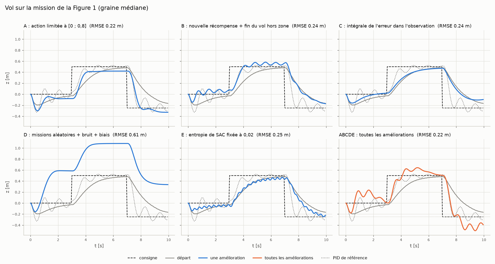
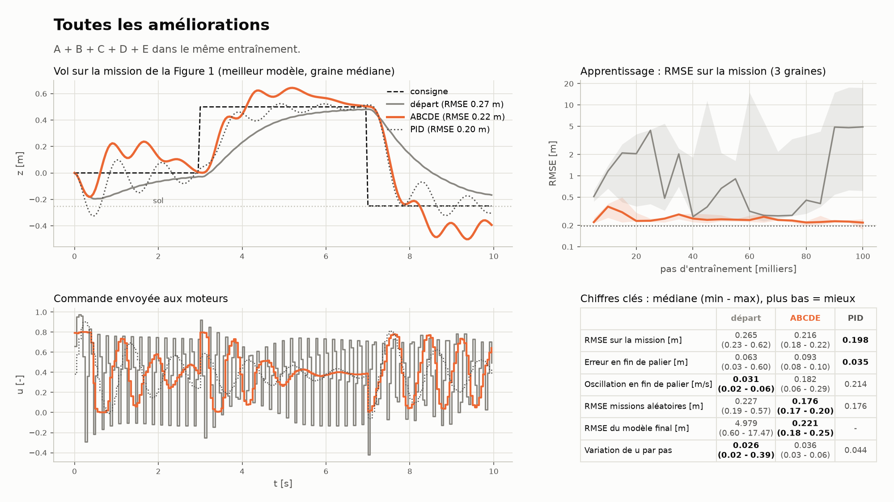
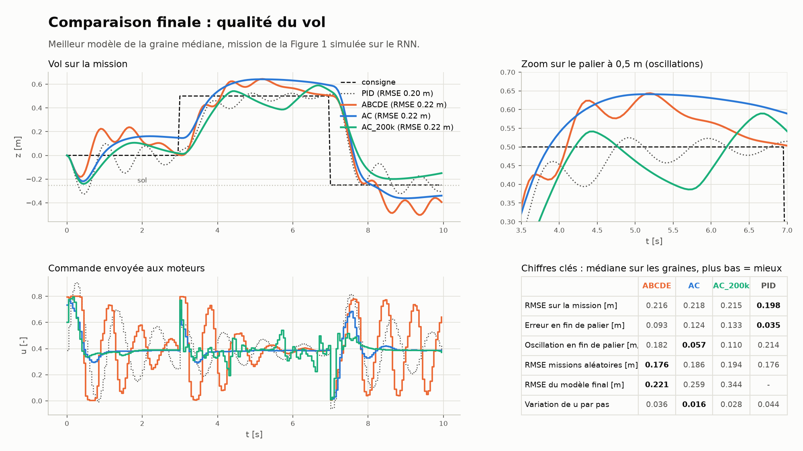

# Étude d'ablation du contrôleur RL (Track B)

But : mesurer l'effet de **chaque** amélioration du contrôleur RL, séparément. On part du modèle de
départ (l'environnement `rl_interface/Env_drone.py`), on ajoute **une seule** amélioration par entraînement,
puis toutes ensemble. Chaque variante est entraînée avec 3 graines ; les chiffres sont des médianes.

## Résultat principal : la qualité du vol

*Vol sur la mission de la Figure 1 (0 → 0,5 → -0,25 m), meilleur modèle de la graine médiane, simulé sur le RNN.
En gris le départ, en bleu une amélioration seule, en orange toutes ensemble, en pointillés le PID de référence.*

| Variante | RMSE mission [m] | Erreur en fin de palier [m] | Oscillation : abs(vz) en fin de palier [m/s] | RMSE du modèle **final** [m] | Variation de u par pas |
|---|---|---|---|---|---|
| départ | 0.265 | 0.063 | 0.031 | 4.979 | 0.026 (jusqu'à 0.39) |
| A : action [0 ; 0,8] | **0.215** | 0.077 | 0.012 | 0.399 | **0.012** |
| B : nouvelle récompense | 0.241 | 0.075 | **0.008** | 0.243 | 0.068 |
| C : intégrale de l'erreur | 0.243 | 0.064 | 0.037 | 1.077 | 0.026 |
| D : missions aléatoires + bruit | 0.606 | 0.587 | 0.019 | 2.710 | 0.013 |
| E : entropie fixée | 0.245 | **0.049** | 0.137 | 0.363 | 0.779 |
| **ABCDE : toutes** | 0.216 | 0.093 | 0.182 | **0.221** | 0.036 |
| PID de référence | 0.198 | 0.035 | 0.214 | - | 0.044 |

Le tableau complet (étendue sur les graines, z min, missions aléatoires, bruit + biais) est dans
[`resultats.md`](resultats.md).

## Ce qu'apporte chaque amélioration
- **Départ** : sa meilleure politique est correcte, mais l'apprentissage est très instable (5 m de RMSE en fin
  d'entraînement, jusqu'à 17 m selon la graine) et la commande oscille sans arrêt d'un pas à l'autre.
- **A, action limitée à [0 ; 0,8]** : le centre de la plage est presque la commande d'équilibre. Vol lisse,
  meilleur RMSE seul, très régulier d'une graine à l'autre ; reste un décalage d'environ 8 cm.
- **B, nouvelle récompense** : le seul apprentissage qui descend régulièrement sans exploser ; vol le plus calme
  et meilleure généralisation aux missions aléatoires.
- **C, intégrale de l'erreur** : vol lisse, mais l'apprentissage diverge ensuite (1,1 m en fin d'entraînement).
- **D, missions aléatoires + bruit** : seul, il échoue : une tâche plus difficile sans les autres aides empêche
  d'apprendre.
- **E, entropie fixée** : le plus précis en fin de palier, mais commande « tout ou rien » (de -1 à +1 à chaque
  pas) : inutilisable sur un vrai drone.
- **ABCDE, toutes ensemble** : le seul entraînement stable du début à la fin, et au niveau du PID sur les missions
  aléatoires. Mais le vol **oscille** et passe sous le sol à l'atterrissage.

## Une figure par amélioration (format diapositive)
Chaque figure montre le vol, la commande, la courbe d'apprentissage et les chiffres clés, face au départ :
[A](figures/presentation/1_A_action.png) ·
[B](figures/presentation/2_B_recompense.png) ·
[C](figures/presentation/3_C_integrale.png) ·
[D](figures/presentation/4_D_robustesse.png) ·
[E](figures/presentation/5_E_entropie.png) ·
[toutes](figures/presentation/6_ABCDE_toutes.png)

Autres figures : [apprentissage](figures/1_apprentissage.png) (RMSE au cours de l'entraînement),
[commandes](figures/3_commandes.png) (u pendant les vols), [bilan](figures/4_bilan.png) (mission, missions
aléatoires, bruit + biais).

## Suite : A + C, pour un vol moins oscillant
Le vol d'ABCDE oscille. A et C donnant les vols les plus lisses, la variante **AC** (action [0 ; 0,8] +
intégrale) est entraînée comme les autres (100 000 pas), et **AC_200k** deux fois plus longtemps.

| Médiane sur 3 graines | ABCDE | AC | AC_200k | PID |
|---|---|---|---|---|
| RMSE mission [m] | 0.216 | 0.218 | 0.215 | **0.198** |
| Erreur en fin de palier [m] | 0.093 | 0.124 | 0.133 | **0.035** |
| Oscillation : abs(vz) en fin de palier [m/s] | 0.182 | **0.057** | 0.110 | 0.214 |
| z min [m] (sol à -0,25) | -0.31 | -0.36 | -0.49 | -0.33 |
| RMSE du modèle final [m] | **0.221** | 0.259 | 0.344 | - |
| Variation de u par pas | 0.036 | **0.016** | 0.028 | 0.044 |

- **AC** : commande la plus lisse et oscillations 3 fois plus faibles qu'ABCDE (et que le PID). Mais la
  correction est lente : dépassement jusqu'à 0,64 m sur le palier à 0,5 m, environ 12 cm d'erreur en fin de
  palier, atterrissage sous le sol. Les graines sont très différentes : la meilleure (graine 0) fait
  3,3 cm d'erreur en fin de palier, au niveau du PID, sans passer sous le sol.
- **AC_200k** : entraîner plus longtemps n'aide pas. Les oscillations lentes reviennent (0,11 m/s) et
  l'apprentissage est moins stable (0,34 m en fin d'entraînement) : sans la récompense B, plus de pas ne fait
  pas mieux converger.
- Piste suivante : **A + B + C**. B rend l'apprentissage stable et le vol calme ; on retire D (qui rend la
  tâche trop difficile) et E (commande « tout ou rien »).

Figures face au départ : [AC](figures/presentation/7_AC_action_integrale.png) ·
[AC_200k](figures/presentation/8_AC_200k_action_integrale_long.png)

## Les variantes

| Variante | Ce qui change par rapport au départ | Pourquoi |
|---|---|---|
| **base** | rien : récompense `-10·abs(e) - 0.05·abs(vz) - 10·max(0, -0.25 - z)`, action u ∈ [-1, 1], observation `[e, vz, az_prev/10, u_prev]`, entropie de SAC automatique | point de comparaison |
| **A** | action limitée à u ∈ [0 ; 0,8] | le centre (0,4) est presque la commande d'équilibre (0,386) : résolution 2,5 fois plus fine là où il faut de la précision |
| **B** | récompense `-abs(e) - 0.1·vz² - 0.5·(u - u_prev)² + 0.5·[abs(e) < 5 cm]`, et fin du vol si z < -0,30 m ou z > 1,5 m (pénalité `-2 × pas restants`) | position + amortissement + commande lisse + bonus de précision ; plus de chute de 500 m qui écrase l'apprentissage |
| **C** | intégrale de l'erreur ajoutée à l'observation (bornée à ±2 m·s) | le « I » d'un PI : supprimer l'erreur statique |
| **D** | entraînement sur des missions aléatoires (2 paliers, instants et niveaux tirés au hasard), avec bruit de mesure (z : 1 cm, vz : 0,05 m/s, az : 0,2 m/s²) et un biais sur az (±0,3 m/s², l'ordre de grandeur de l'erreur du RNN) | généralisation à d'autres consignes et robustesse à l'écart modèle / simulateur |
| **E** | coefficient d'entropie de SAC fixé à 0,02 (au lieu de `auto`, monté à 1,4 lors du premier essai) | moins d'exploration aléatoire une fois la tâche apprise |
| **ABCDE** | toutes les améliorations | résultat final |
| **AC**, **AC_200k** | A + C (100 000 et 200 000 pas) | suite de l'étude : garder les deux améliorations qui donnent le vol le plus lisse |

## Protocole (identique pour toutes les variantes)
- SAC, `MlpPolicy` 64×64, 100 000 pas (500 vols de 10 s), **3 graines** (0, 1, 2) par variante : le hasard
  de l'initialisation compte beaucoup en RL (le départ va de 0,23 à 0,62 m selon la graine).
- Tous les 5 000 pas : un vol déterministe sur la mission de la Figure 1, sur le RNN. Le modèle au RMSE le plus
  bas est gardé (« meilleur modèle ») ; le RMSE du modèle final mesure la stabilité de l'apprentissage.
- Tests du meilleur modèle, sur le RNN : mission de la Figure 1 sans bruit ; 20 missions aléatoires jamais vues
  (généralisation) ; mission + bruit + biais, 10 vols (robustesse).
- Métriques :
  - RMSE de z (les deux sauts de consigne coûtent environ 0,15 m même à un bon contrôleur) ;
  - erreur moyenne sur la dernière seconde de chaque palier (précision) ;
  - |vz| moyen sur cette même seconde (oscillations : 0 pour un drone stabilisé) ;
  - z min (le sol est à -0,25 m) ; variation moyenne de u d'un pas à l'autre (douceur de la commande).
- Référence : un **PID** `u = 0,386 + Kp·e + Ki·∫e - Kd·vz` réglé sur le même RNN (grille de gains, RMSE le plus bas).

## Fichiers

| Fichier | Rôle |
|---|---|
| `drone_env_ablation.py` | Environnement : `Env_drone.py` + les améliorations activables (`VARIANTES`) |
| `train_variant.py` | Un entraînement : `python train_variant.py <variante> <graine> [pas]` |
| `run_all.py` | Tous les entraînements (7 variantes x 3 graines, puis AC et AC_200k), 7 en parallèle, puis l'analyse : `python run_all.py [parallèles] [pas]` (un entraînement déjà terminé n'est pas relancé) |
| `analyse.py` | Figures (`figures/`, `figures/presentation/`) et tableau des résultats (`resultats.md`) |
| `runs/<variante>_s<graine>/` | Un entraînement : évaluations, meilleur modèle et modèle final (`.zip` SB3), vol, export MATLAB (`policy.mat`, `traj_model.mat`) |

Durée : environ 45 min pour les 21 entraînements sur un portable 8 cœurs, en mode d'alimentation
« Performances optimales » (1 thread par entraînement, environ 115 pas/s chacun).
