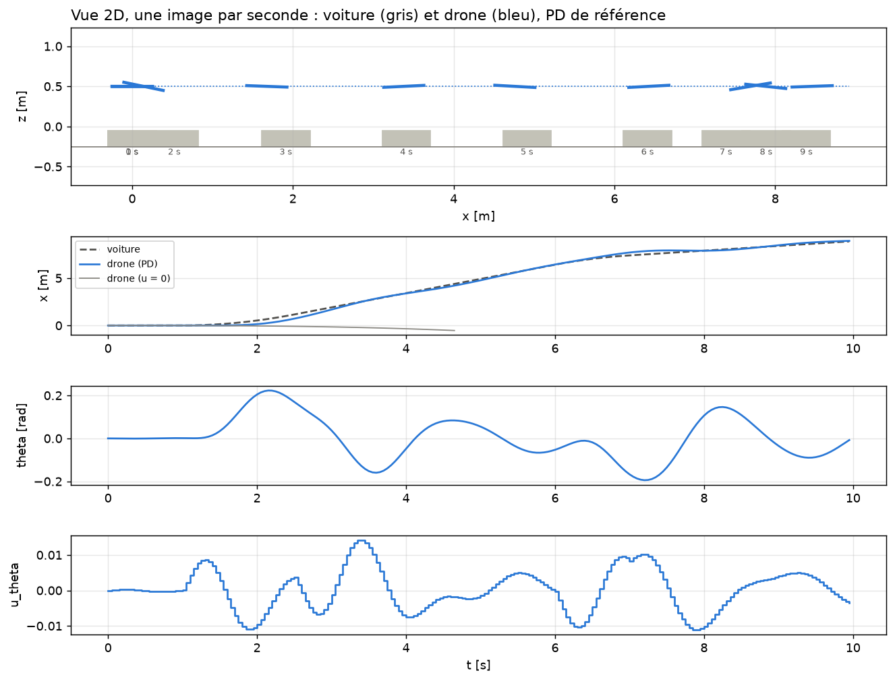

# Environnement RL en x : le drone suit la voiture

`Env_drone_x.py` : environnement Gymnasium en 2D (x horizontal, z vertical) où la voiture roule et le drone la
suit, commandé en tangage (u_theta). Il reprend la structure de `rl_interface/Env_drone.py` (environnement de z) :
`lire_txt`, `ModeleRNN`, la classe d'environnement avec `mission`, `_mesures`, `_observation` et `step` en 6 étapes.

L'altitude est supposée tenue par le contrôleur de z (RNN de az + RL de z) : z ne fait pas partie de cet
environnement, il sert seulement à l'affichage (`Z_VOL = 0,5 m`).

## Dynamique simulée

```
u_theta = 0,02 x action                         action de l'agent dans [-1, 1]
a_theta = RNN_a_theta(u_theta)                   RNN 16 neurones (identification_RNN_x_theta/RNN_a_theta_16neurones)
theta, w   intégrés à partir de a_theta          (même schéma que z, vz à partir de az dans Env_drone.py)
ax      = 9,45 x theta                           relation mesurée sur la base (proche de g.theta)
x, vx      intégrés à partir de ax
voiture : accélère ou freine (a_car) vers une vitesse visée, x_car intégré
```

`DroneEnvX(modele_ax='rnn')` remplace `ax = 9,45.theta` par le RNN de ax (32 neurones). Déconseillé : ce RNN ne
connaît pas le theta de l'environnement, les deux modèles se contredisent et le même PD suit 13 fois moins bien
(RMSE 2,41 m au lieu de 0,18 m).

## Ce qui change par rapport à `Env_drone.py`

| Élément | `Env_drone.py` (z) | `Env_drone_x.py` (x) | Pourquoi |
|---|---|---|---|
| Modèles | RNN de az (16 neurones), normalisation écrite en dur (`20*... - 9.81`) | RNN de a_theta ; normalisation lue dans `normalization.txt`, n'importe quel nombre de neurones | même classe `ModeleRNN`, réutilisable pour tous les RNN du groupe |
| Chemins | relatifs au dossier courant | relatifs au fichier | l'environnement se charge depuis n'importe quel dossier |
| Action | u ∈ [-1, 1] envoyé tel quel | action ∈ [-1, 1], **u_theta = 0,02·action** | la plage utile (base d'apprentissage : ±0,021) ; Stable-Baselines3 recommande une action dans [-1, 1] |
| Physique | az → z, vz | a_theta → theta, w ; ax = 9,45·theta → x, vx ; voiture | le drone avance en s'inclinant |
| Mission | paliers de z_ref (0 → 0,5 → -0,25 m) | **la voiture roule** : démarre à 1 s, monte à 1,5 m/s, ralentit à 0,5 m/s à 6 s (accélération 1 m/s²) | suivre la voiture |
| Missions aléatoires | non | `voiture_aleatoire=True` : 2 changements de vitesse (instants, vitesses 0 à 2 m/s, accélération 0,5 à 1,5 m/s² tirés au hasard) | entraîner sur des situations variées (piste D de l'étude d'ablation) |
| Mesures `info["m"]` | t, z, vz, az_prev, z_ref, u_prev | t, x, vx, theta, w, atheta_prev, x_car, v_car, u_prev | theta vient de l'intégration du gyromètre (le capteur de theta du simulateur est inutilisable) |
| Observation | `[e_z, vz, az_prev/10, u_prev]` | `[e_x, v_rel, theta/0,3, w, u_prev/0,02]` avec e_x = x_car - x, v_rel = v_car - vx | chaque grandeur de l'ordre de 1 ; le drone doit tenir lui-même son tangage, il a besoin de theta et w |
| Fin du vol | jamais avant 10 s | **si abs(theta) > 0,6 rad ou abs(e_x) > 5 m**, avec une pénalité `-2 x pas restants` | hors du domaine appris par les RNN (theta de la base : ±0,47 rad), ou voiture perdue ; la pénalité empêche l'agent de « s'écraser exprès » |

### La récompense, terme par terme

| `Env_drone.py` | `Env_drone_x.py` | Rôle |
|---|---|---|
| `-10·abs(e_z)` | `-abs(e_x)` | suivre la voiture ; poids 1 au lieu de 10 (récompense de l'ordre de 1 par pas : l'apprentissage du critique est plus stable, leçon de la variante B) |
| `-0.05·abs(vz)` | `-0.1·v_rel²` | rouler à la vitesse de la voiture plutôt qu'être immobile : amortit les oscillations autour d'elle |
| `-10·max(0, -0.25 - z)` (sol) | supprimé | pas de sol à éviter sur x ; remplacé par la fin du vol hors zone |
| - | `-1.0·theta²` | rester peu incliné (confort, domaine de validité des RNN) |
| - | `-0.5·(Δu_theta / 0,02)²` | commande lisse (leçon de la variante B, plutôt que pénaliser l'accélération) |
| - | `+0.5` si `abs(e_x) < 10 cm` | bonus de précision : être pile au-dessus de la voiture |
| - | `-2·(N_STEPS - k)` à la fin anticipée du vol | voir « Fin du vol » |

Ordres de grandeur sur la mission d'évaluation : ne rien faire (u = 0) donne -365 (voiture perdue après 4,7 s) ;
le PD de référence donne +22.

## Vérification : `test_env_x.py`
- `check_env` de Stable-Baselines3 : conforme (avec `modele_ax='theta'` et `'rnn'`).
- **PD en cascade de référence** (comme le PID de référence pour z) :
  `theta_visé = 0,2·e_x + 0,5·v_rel` (borné à ±0,4 rad), puis `u_theta = 0,08·(theta_visé - theta) - 0,06·w`.
  Gains réglés sur une grille, critère = somme des récompenses de l'environnement.
  - mission d'évaluation : RMSE de suivi 0,18 m, écart max 0,45 m, theta dans ±0,22 rad ;
  - 20 profils de voiture aléatoires : RMSE moyen 0,16 m, aucun vol interrompu.



## Entraîner un agent

```python
from stable_baselines3 import SAC
from Env_drone_x import DroneEnvX

env = DroneEnvX(voiture_aleatoire=True)          # entraînement sur des profils de voiture variés
agent = SAC("MlpPolicy", env, policy_kwargs=dict(net_arch=[64, 64]), verbose=1)
agent.learn(total_timesteps=100_000)
agent.save("sac_drone_x")
```

Évaluer sur la mission fixe avec `DroneEnvX()` et comparer au PD de référence. L'export MATLAB fourni
(`rl_interface/export_policy.py`, `rl_controller.m`) est écrit pour z (mesures z, vz, az_prev, z_ref) : le vol en x
sur le simulateur demandera un `rl_controller` et une boucle Simulink propres à x.
